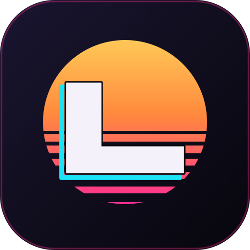

# Components — v2 "Dusk Wire" (copy-paste for Eleventy)
Unofficial fan site — not affiliated with Rockstar Games. Convention: BEM `.block__element--modifier`; theme any block with a `.cat-*` helper (sets `--accent`). All markup below is copied from `mockup-home.html` / `mockup-guide.html` / `mockup-collectibles.html` (placeholder text only). CSS section numbers refer to the map at the top of `components.css`. Class renames vs v1: see `UPGRADE.md`.

## 0. Page shell
```html
<link rel="preload" href="fonts/Anton-Regular.woff2" as="font" type="font/woff2" crossorigin>   <!-- the ONLY preload -->
<link rel="stylesheet" href="fonts.css"><link rel="stylesheet" href="tokens.css"><link rel="stylesheet" href="components.css">
<noscript><style>.spoiler-toggle,.ticker__pause{display:none}</style></noscript>
<body>
  <a class="skip-link" href="#main">Skip to content</a>
  <div class="disclaimer-bar"><div class="container"><p class="disclaimer-bar__text"><strong>Unofficial fan site — not affiliated with Rockstar Games</strong></p></div></div>
  <header class="site-header">…</header>   <!-- then .ticker on home -->
  <main id="main">…</main>
  <footer class="site-footer">…</footer>
  <script src="ui.js" defer></script>
</body>
```

## 1. Header · nav · search · spoiler switch (§2)
Slim bar: wordmark (Anton text), inline nav ≥64rem, spoiler switch, search button (dropdown at all sizes), ONE pill CTA (`.site-header__cta`, shown ≥75rem), menu button <64rem. Active nav item: `aria-current="page"` (accent underline).
```html
<header class="site-header">
  <div class="container site-header__inner">
  <a class="site-header__brand" href="mockup-home.html" aria-label="Leonida Guides — home">
    
    <span class="site-header__wordmark" aria-hidden="true">Leonida <span>Guides</span></span>
  </a>
  <nav class="nav" id="site-nav" aria-label="Primary"><ul class="nav__list"><li><a class="nav__link cat-missions" href="mockup-hub.html">Missions</a></li><li><a class="nav__link cat-money" href="mockup-hub.html">Money</a></li><li><a class="nav__link cat-collectibles" href="mockup-hub.html">Collectibles</a></li><li><a class="nav__link cat-vehicles" href="mockup-hub.html">Vehicles</a></li><li><a class="nav__link cat-weapons" href="mockup-hub.html">Weapons</a></li><li><a class="nav__link cat-glitches" href="mockup-hub.html">Fixes</a></li><li><a class="nav__link cat-ps5" href="mockup-hub.html">More topics</a></li></ul></nav>
  <div class="site-header__actions">
    <button class="spoiler-toggle" type="button" role="switch" aria-checked="false" data-spoiler-toggle><span class="spoiler-toggle__track" aria-hidden="true"></span><span class="spoiler-toggle__label">Show all spoilers</span><span class="spoiler-toggle__state" data-spoiler-state>Off</span></button>
    <button class="icon-btn site-header__search-toggle" type="button" aria-label="Search" aria-expanded="false" aria-controls="search-panel"><svg class="" viewBox="0 0 24 24" aria-hidden="true"><circle cx="11" cy="11" r="7"/><path d="m20 20-3.5-3.5"/></svg></button>
    <a class="btn btn--cta btn--sm site-header__cta" href="mockup-collectibles.html">Checklists</a>
    <button class="icon-btn site-header__toggle" type="button" aria-label="Menu" aria-expanded="false" aria-controls="site-nav"><span class="icon-btn__open"><svg class="" viewBox="0 0 24 24" aria-hidden="true"><path d="M4 7h16M4 12h16M4 17h16"/></svg></span><span class="icon-btn__close"><svg class="" viewBox="0 0 24 24" aria-hidden="true"><path d="M6 6l12 12M18 6 6 18"/></svg></span></button>
  </div>
  <div class="site-header__search search" role="search">
    <form class="search__form" action="mockup-search.html">
      <svg class="search__icon" viewBox="0 0 24 24" aria-hidden="true"><circle cx="11" cy="11" r="7"/><path d="m20 20-3.5-3.5"/></svg>
      <input class="search__input" type="search" name="q" placeholder="Search guides…" aria-label="Search guides" autocomplete="off" aria-expanded="false" aria-controls="search-panel">
    </form>
    <div class="search__panel" id="search-panel" hidden>
      <p class="search__group-title label">Guides</p>
      <a class="search__result cat-money" href="mockup-guide.html"><span class="chip">Money</span><span class="search__result-title"><mark>Money</mark> Method #1</span><span class="search__result-excerpt">Lorem ipsum dolor sit amet, consectetur adipiscing.</span></a>
      <a class="search__result cat-money" href="mockup-guide.html"><span class="chip">Money</span><span class="search__result-title"><mark>Money</mark> Method #2</span><span class="search__result-excerpt">Sed do eiusmod tempor incididunt ut labore.</span></a>
      <a class="search__result cat-beginner" href="mockup-guide.html"><span class="chip">Beginner</span><span class="search__result-title">Beginner tips placeholder</span><span class="search__result-excerpt">Early <mark>money</mark> basics, lorem ipsum.</span></a>
      <p class="search__group-title label">Topics</p>
      <a class="search__result cat-money" href="mockup-hub.html"><span class="chip">Hub</span><span class="search__result-title">All <mark>Money</mark> guides</span></a>
      <p class="search__empty" hidden>No guides found. Try a shorter term.</p>
      <div class="search__footer"><span>↑↓ to navigate · Esc to close</span><a href="mockup-search.html">See all results</a></div>
    </div>
  </div>
  </div>
</header>
```

## 2. Ticker (§3) — CSS-only scroll, pauses on hover/focus, `ui.js` reveals the pause button; reduced motion → static scroll row
```html
<div class="ticker" role="region" aria-label="Latest updates">
  <span class="ticker__label">Live</span>
  <div class="ticker__viewport"><div class="ticker__track"><ul class="ticker__group"><li class="ticker__item cat-missions"><a class="ticker__link" href="mockup-guide.html">New walkthrough: Mission walkthrough title placeholder</a><span class="ticker__time">2h ago</span></li> … </ul><ul class="ticker__group" aria-hidden="true"> …same items, links tabindex="-1" </ul></div></div>
```

## 3. Chips · buttons · badges (§4)
`.chip` = slanted category label (filled with `--accent`); `.chip--ghost` tinted; `.chip--filter` = pill toggle button with `aria-pressed`. Buttons: `.btn`, `.btn--cta` (gradient pill), `.btn--ghost`, `.btn--sm`. Badges:
```html
<span class="badge badge--updated"><svg class="icon" viewBox="0 0 24 24" aria-hidden="true"><circle cx="12" cy="12" r="9"/><path d="M12 7v5l3 2"/></svg>Updated 18 Nov 2026</span>
<span class="badge badge--spoiler badge--spoiler-none">Spoiler-free</span>
<span class="badge badge--spoiler badge--spoiler-minor">Minor spoilers</span>
<span class="badge badge--spoiler badge--spoiler-major">Major spoilers</span>
<span class="badge badge--official">…Official source</span>
<span class="badge badge--rumour">…Unverified</span>
<span class="badge badge--new">New</span>
```

## 4. Section heading, marquee, promo (§5)
```html
<section class="section" aria-labelledby="latest-guides"><div class="container">
  <div class="section__head"><div><span class="section__kicker">Fresh</span><h2 class="section__title" id="latest-guides">Latest guides</h2></div><a class="section__link" href="…">All guides</a></div>
  …
</div></section>   <!-- last section before the footer: add .section--last -->
```
```html
<div class="marquee" aria-hidden="true"><div class="marquee__track"><ul class="marquee__group"><li class="marquee__item">Guides</li> … </ul><ul class="marquee__group" aria-hidden="true"> …duplicate group </ul></div></div>
```
```html
<div class="promo cat-collectibles">
  <div><h2 class="promo__title" id="promo-title">Track every collectible</h2><p class="promo__text">Lorem ipsum dolor sit amet, consectetur adipiscing elit, sed do eiusmod tempor incididunt ut labore. Progress is saved on your device only.</p></div>
  <div class="promo__actions"><a class="btn btn--cta" href="mockup-collectibles.html">Open the checklist</a><a class="btn btn--ghost" href="mockup-hub.html">Browse topics</a></div>
</div>
```

## 5. Hero + ranked "Latest" wire (§6) — wire sits BESIDE the hero ≥64rem, below on mobile
```html
<article class="hero-feature cat-missions" aria-labelledby="hero-title">
    <picture class="hero-feature__art"><source type="image/avif" srcset="img/hero-768.avif 768w, img/hero-1280.avif 1280w, img/hero-1920.avif 1920w" sizes="(min-width:64rem) 900px, 100vw"><source type="image/webp" srcset="img/hero-768.webp 768w, img/hero-1280.webp 1280w, img/hero-1920.webp 1920w" sizes="(min-width:64rem) 900px, 100vw"></picture>
    <div class="hero-feature__shade" aria-hidden="true"></div>
    <div class="hero-feature__inner">
      <div class="hero-feature__tags"><a class="chip" href="mockup-hub.html" style="position:relative;z-index:2">Featured · Missions</a><span class="badge badge--updated"><svg class="icon" viewBox="0 0 24 24" aria-hidden="true"><circle cx="12" cy="12" r="9"/><path d="M12 7v5l3 2"/></svg>Updated 18 Nov 2026</span><span class="badge badge--spoiler badge--spoiler-none">Spoiler-free</span></div>
      <h1 class="hero-feature__title" id="hero-title"><a href="mockup-guide.html">Mission walkthrough <em>title placeholder</em></a></h1>
      <p class="hero-feature__lede">Lorem ipsum dolor sit amet, consectetur adipiscing elit, sed do eiusmod tempor incididunt ut labore.</p>
      <div class="hero-feature__foot"><div class="byline byline--compact">
  <span class="byline__avatar"></span>
  <div class="byline__body"><span class="byline__author">By Leonida Guides Team</span>
  <p class="byline__dates"><span class="byline__updated">Updated <time datetime="2026-11-18">18 Nov 2026</time></span><span>Published <time datetime="2026-11-14">14 Nov 2026</time></span><span>6 min read</span></p></div>
</div><div class="hero-feature__actions"><a class="btn btn--cta" href="mockup-guide.html">Read the guide</a><a class="btn btn--ghost" href="mockup-collectibles.html">Checklist</a></div></div>
    </div>
  </article>
```
```html
<aside class="wire" aria-labelledby="wire-title">
    <div class="wire__head"><h2 class="wire__title" id="wire-title">Latest</h2><span class="wire__live">Updated daily</span></div>
    <ol class="wire__list"><li class="wire__item cat-money"><div class="wire__body"><span class="wire__cat">Money</span><a class="wire__link" href="mockup-guide.html">Money Method #1: Placeholder Route</a><span class="wire__meta">2h ago · 5 min</span></div></li> … </ol>
    <div class="wire__foot"><a class="section__link" href="mockup-hub.html">All guides</a></div>
  </aside>
```

## 6. Trending strip (§7) — horizontal scroll row
```html
<section class="trending" aria-labelledby="trending-title">
  <div class="container trending__inner">
  <h2 class="trending__title" id="trending-title"><svg class="icon" viewBox="0 0 24 24" aria-hidden="true"><path d="M12 3c1 3.5 5 5.5 5 10a5 5 0 0 1-10 0c0-2 1-3 2-4 .3 1.2 1 2 2 2 0-3-1-5 1-8z"/></svg><span>Trending</span><span class="visually-hidden">now</span></h2>
  <ol class="trending__list"><li class="trending__item cat-money"><span class="trending__rank">1</span><a class="trending__link" href="mockup-guide.html">Money Method #1: placeholder</a></li> … </ol>
  </div>
</section>
```

## 7. Quick Access grid (§7) — 2 / 4 / 8 columns
```html
<ul class="quick-access__list"><li class="quick-access__item cat-missions"><span class="quick-access__icon"><svg class="" viewBox="0 0 24 24" aria-hidden="true"><path d="M5 21V4M5 4h11l-2 4 2 4H5"/></svg></span><a class="quick-access__link" href="mockup-hub.html">Missions</a><span class="quick-access__count">14 guides</span></li> … </ul>
```

## 8. Popular tiles (§7) — ranked image tiles; glow lives on `.tile-row__item` (clip-path clips shadows)
```html
<ul class="tile-row"><li class="tile-row__item cat-missions"><article class="tile"><div class="tile__art"></div><div class="tile__shade" aria-hidden="true"></div><span class="tile__rank">#1</span><div class="tile__body"><span class="tile__cat">Missions</span><h3 class="tile__title"><a class="tile__link" href="mockup-guide.html">Mission walkthrough title placeholder</a></h3></div></article></li> … </ul>
```

## 9. Guide card + grid + filter chips (§8)
Mobile: non-feature cards become horizontal rows; ≥40rem 2 cols; ≥64rem 4 cols with `.guide-card--feature` spanning 2×2. Modifiers: `--feature`, `--compact` (sidebar/related), `.is-flip` (mirrored art + opposite diagonal cut). `data-cat` + `[data-filter]` buttons drive `ui.js` filtering (all cards visible without JS).
```html
<div class="chip-row" role="group" aria-label="Filter guides" data-filter-group data-filter-scope="#latest-grid"><button class="chip chip--filter" type="button" data-filter="all" aria-pressed="true">All</button><button class="chip chip--filter" type="button" data-filter="missions" aria-pressed="false">Missions</button><button class="chip chip--filter" type="button" data-filter="money" aria-pressed="false">Money</button><button class="chip chip--filter" type="button" data-filter="collectibles" aria-pressed="false">Collectibles</button><button class="chip chip--filter" type="button" data-filter="vehicles" aria-pressed="false">Vehicles</button><button class="chip chip--filter" type="button" data-filter="weapons" aria-pressed="false">Weapons</button><button class="chip chip--filter" type="button" data-filter="glitches" aria-pressed="false">Glitches & fixes</button></div>
<ul class="guide-grid" id="latest-grid"><li class="guide-card cat-money guide-card--feature" data-cat="money">
  <div class="guide-card__media"><div class="guide-card__art"></div><span class="guide-card__chip chip">Money</span></div>
  <div class="guide-card__body">
  <h3 class="guide-card__title"><a class="guide-card__link" href="mockup-guide.html">Money Method #1: Placeholder Route</a></h3>
  <p class="guide-card__excerpt">Lorem ipsum dolor sit amet, consectetur adipiscing elit, sed do eiusmod tempor incididunt ut labore.</p>
  <div class="guide-card__meta"><span class="guide-card__cat">Money</span><span class="guide-card__badge"><span class="badge badge--spoiler badge--spoiler-none">Spoiler-free</span></span><span class="guide-card__badge"><span class="badge badge--updated"><svg class="icon" viewBox="0 0 24 24" aria-hidden="true"><circle cx="12" cy="12" r="9"/><path d="M12 7v5l3 2"/></svg>Updated 18 Nov 2026</span></span><span>5 min</span></div>
  </div>
</li> … </ul>
```

## 10. Guide page (IGN pattern) — breadcrumbs, article head, byline, 3-column layout, ToC (§9)
```html
<nav class="breadcrumbs" aria-label="Breadcrumb"><ol class="breadcrumbs__list"><li class="breadcrumbs__item"><a class="breadcrumbs__link" href="mockup-home.html">Home</a></li><li class="breadcrumbs__item"><a class="breadcrumbs__link" href="mockup-hub.html">Missions</a></li><li class="breadcrumbs__item" aria-current="page">Mission walkthrough placeholder</li></ol></nav>
```
```html
<header class="article-head">
  <div class="container article-head__inner">
  <div class="article-head__tags"><a class="chip" href="mockup-hub.html">Missions</a><span class="badge badge--updated"><svg class="icon" viewBox="0 0 24 24" aria-hidden="true"><circle cx="12" cy="12" r="9"/><path d="M12 7v5l3 2"/></svg>Updated 18 Nov 2026</span><span class="badge badge--official"><svg class="icon" viewBox="0 0 24 24" aria-hidden="true"><path d="m5 12 5 5 9-10"/></svg>Official source</span><span class="badge badge--spoiler badge--spoiler-minor">Minor spoilers</span></div>
  <h1 class="article-head__title">Mission walkthrough title placeholder</h1>
  <p class="article-head__lede">Lorem ipsum dolor sit amet, consectetur adipiscing elit, sed do eiusmod tempor incididunt ut labore. Sed ut perspiciatis unde omnis iste natus error sit voluptatem.</p>
  <div class="byline">
  <span class="byline__avatar"></span>
  <div class="byline__body"><span class="byline__author">By Leonida Guides Team</span>
  <p class="byline__dates"><span class="byline__updated">Updated <time datetime="2026-11-18">18 Nov 2026</time></span><span>Published <time datetime="2026-11-14">14 Nov 2026</time></span><span>6 min read</span></p></div>
</div>
  </div>
</header>
```
```html
<div class="container guide-layout">
  <nav class="guide-layout__toc" aria-label="On this page"><details class="toc" data-collapsible data-toc open><summary class="toc__summary">On this page</summary><ol class="toc__list"><li class="toc__item"><a class="toc__link" href="#overview">Overview</a></li><li class="toc__item"><a class="toc__link" href="#requirements">Requirements</a></li><li class="toc__item"><a class="toc__link" href="#steps">Step by step</a></li><li class="toc__item"><a class="toc__link" href="#rewards">Rewards</a></li><li class="toc__item"><a class="toc__link" href="#spoilers">Story details (spoilers)</a></li><li class="toc__item"><a class="toc__link" href="#faq">FAQ</a></li></ol></details></nav>
  <article class="guide-layout__main"> …picture.article__hero, div.prose … </article>
  <aside class="guide-layout__aside" aria-label="Related">
  <div class="side-card"><h2 class="side-card__title">Related guides</h2><ul class="related"> …3× li.guide-card.guide-card--compact… </ul></div>
  <div class="ad-slot ad-slot--rectangle">…</div>
</aside>
</div>
```

`.toc` is a `<details data-collapsible open>`: open + sticky sidebar ≥64rem, collapsed on mobile (ui.js). Scroll-spy sets `aria-current="true"` on `.toc__link`. `.read-progress` (fixed bar, `--p` set by ui.js). Prose pieces unchanged from v1: `.prose`, `.quick-facts`, `.steps/.step`, `.callout`, `.table-wrap/.table` (add `tabindex="0" role="region" aria-label` to a scrollable wrapper), `.faq`, `.source-credit`, `.ad-slot`, `.map-embed`.

## 11. Spoiler UI (§4 badge, §2 switch, §10 block)
Blurred decoy bars come from `summary::after` (no spoiler text is rendered while closed); `<details>` = works without JS and is keyboard accessible (Enter/Space). Hint text ("Tap to reveal" / "Hide") is CSS-generated. Modifier `.spoiler--major` switches the accent to red.
```html
<details class="spoiler" data-spoiler>
      <summary class="spoiler__summary"><span class="spoiler__head"><span class="badge badge--spoiler badge--spoiler-minor">Minor spoilers</span><span class="spoiler__label">Placeholder spoiler section A</span><span class="spoiler__hint"></span></span></summary>
      <div class="spoiler__body"><p>Placeholder text only. Lorem ipsum dolor sit amet, consectetur adipiscing elit, sed do eiusmod tempor incididunt ut labore et dolore magna aliqua.</p><p>Ut enim ad minim veniam, quis nostrud exercitation ullamco laboris nisi ut aliquip.</p></div>
    </details>
```

Page-level switch (header; `ui.js` toggles every `details.spoiler` and stores `localStorage["lg-spoilers"] = "on" | "off"`; hidden without JS via `<noscript>`):
```html
<button class="spoiler-toggle" type="button" role="switch" aria-checked="false" data-spoiler-toggle><span class="spoiler-toggle__track" aria-hidden="true"></span><span class="spoiler-toggle__label">Show all spoilers</span><span class="spoiler-toggle__state" data-spoiler-state>Off</span></button>
```

## 12. Checklist + progress card · embedded post · gallery + lightbox (§12) — `mockup-collectibles.html`
`ui.js`: `[data-tracker="id"]` list + `[data-tracker-progress="id"]` card; state saved as `lg-track-<id>`. Lightbox is a native `<dialog>` (Esc closes, ←/→ navigate).
```html
<div class="progress-card" data-tracker-progress="collectibles-demo"><div class="progress-card__top"><span class="label">Progress</span><span class="progress-card__count" data-tracker-count>0 / 8</span><button class="btn btn--ghost btn--sm" type="button" data-tracker-reset>Reset</button></div><div class="progress-card__bar" role="progressbar" aria-label="Collectibles found" aria-valuemin="0" aria-valuemax="100" aria-valuenow="0"><span class="progress-card__fill"></span></div></div>
<ul class="checklist" data-tracker="collectibles-demo"><li class="checklist__item"><label class="checklist__label"><input class="checklist__input" type="checkbox"><span class="checklist__box" aria-hidden="true"></span><span class="checklist__text">Collectible placeholder 01<span class="checklist__meta">Area placeholder · Lorem ipsum dolor sit amet</span></span></label></li> … </ul>
```
```html
<figure class="embed-post" style="margin:0"><div class="embed-post__head"><span class="embed-post__avatar"></span><div><span class="embed-post__name">Account placeholder</span><span class="embed-post__handle">@placeholder</span></div></div><p class="embed-post__text">Placeholder post text. Lorem ipsum dolor sit amet, consectetur adipiscing elit.</p><div class="embed-post__meta"><span>18 Nov 2026</span><a href="mockup-home.html">View original post</a></div></figure>
```
```html
<ul class="gallery"><li class="gallery__item"><button class="gallery__open" type="button" data-full="img/crop-skyline.webp" data-caption="Skyline placeholder — caption placeholder"></button><span class="gallery__caption">Skyline placeholder<span class="gallery__credit">Image: Leonida Guides (own art)</span></span></li> … </ul>
<dialog class="lightbox" aria-label="Image viewer"><p class="lightbox__caption"></p><div class="lightbox__bar"><button class="btn btn--ghost btn--sm" type="button" data-lb-prev>Previous</button><button class="btn btn--ghost btn--sm" type="button" data-lb-next>Next</button><button class="btn btn--cta btn--sm" type="button" data-lb-close>Close</button></div></dialog>
```

## 13. Footer (§11)
```html
<footer class="site-footer">
  <div class="container">
  <div class="site-footer__grid"> … brand + 3 nav columns … </div>
  <div class="site-footer__disclaimer"><p class="site-footer__disclaimer-strong">Unofficial fan site — not affiliated with Rockstar Games</p>
    <p class="site-footer__legal">Leonida Guides is an independent fan project. All trademarks belong to their respective owners. This site is not endorsed by, directly affiliated with, or sponsored by Rockstar Games or Take-Two Interactive.</p></div>
  </div>
</footer>
```

## 14. Kept from v1 (unchanged markup — see `legacy/components.v1.md`)
Search results page (`.result*`), hub header + toolbar + pagination, map embed, source credit, ad slot, FAQ, article-asset kit (`article-assets/README.md`), per-guide OG image.

## Accessibility · motion · performance notes
- Every card/tile/wire/trending row has ONE real link whose `::after` stretches over the box (no nested links); chips inside cards are `<span>`s.
- Focus ring 2px cyan; touch targets ≥44px (filter chips ≥40px); axe WCAG 2.2 AA clean on home/guide/collectibles/hub (`node src/test_redesign.mjs`).
- `prefers-reduced-motion`: ticker/marquee stop (static scroll rows, duplicate groups hidden), hover lifts off. `prefers-reduced-data`: hero image dropped.
- JS ≈ 4.7 KB min; everything works without it except menu/search/switch/filters (and those degrade to visible content).
- LCP image = `hero-768` (≈25 KB AVIF 14 KB) on home, `cat-missions-768` on the guide page; everything below the fold is `loading="lazy"` with explicit width/height.
